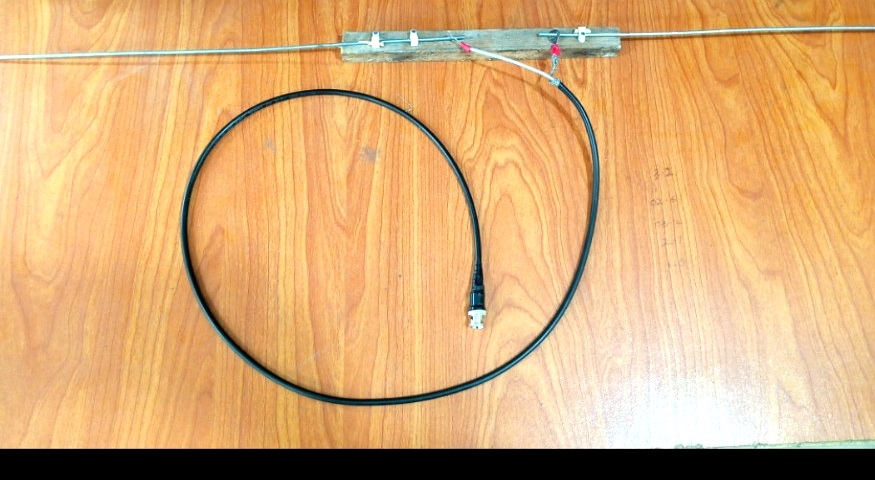
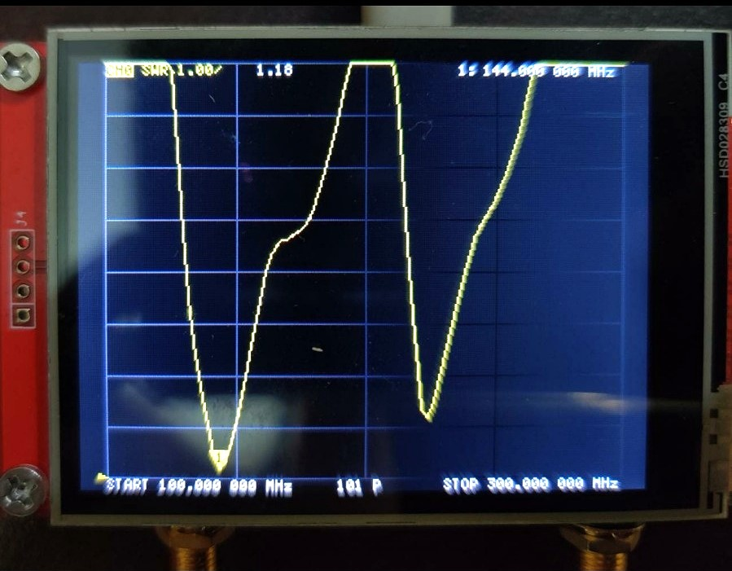

# 144 MHz Dipole Antenna Design, Simulation & Hardware Implementation

## Project Overview

This project focuses on the design, electromagnetic simulation, fabrication, and hardware testing of a dipole antenna operating around **144 MHz**, within the 2-metre amateur radio band.

The antenna was designed and simulated using **Ansys HFSS** and subsequently fabricated and tested using a Vector Network Analyzer (VNA).

## Project Objectives

- Design a dipole antenna for 144 MHz operation.
- Develop a 3D electromagnetic model using Ansys HFSS.
- Analyze antenna impedance matching and return loss.
- Fabricate the antenna according to the designed structure.
- Perform practical measurements using a VNA.
- Evaluate the agreement between simulated and measured performance.

## Design and Simulation

The antenna geometry was developed in Ansys HFSS.

The simulation was used to evaluate the antenna's S11 response and resonant characteristics.

### HFSS Antenna Model

### Simulated S11 Results

**Simulation observations:**

- Approximate resonant frequency: 147.16 MHz
- Minimum S11: approximately -16 dB
- Lower -10 dB frequency: approximately 141.04 MHz
- Upper -10 dB frequency: approximately 156.64 MHz
- Approximate -10 dB bandwidth: 15.60 MHz

## Hardware Fabrication

Following the simulation, the antenna was physically fabricated and assembled with a coaxial feeding arrangement.

### Fabricated Antenna

## Hardware Testing and Measurements

The fabricated antenna was tested using a Vector Network Analyzer (VNA) to evaluate its impedance matching characteristics.

### Measured S11

- Operating frequency marker: 144 MHz
- Measured S11: approximately -17.70 dB

### Measured VSWR

- Operating frequency marker: 144 MHz
- Displayed VSWR: approximately 1.18

These measurements indicate promising impedance matching around the intended operating frequency.

**Measurement note:** The displayed S11 and VSWR values should be rechecked at the same frequency and calibration conditions because they are not mathematically equivalent as currently reported.

## Results Summary

| Parameter | Result |
|---|---:|
| Target frequency | 144 MHz |
| Simulated resonance | 147.16 MHz |
| Simulated minimum S11 | ~ -16 dB |
| Simulated bandwidth | ~15.60 MHz |
| Hardware S11 | ~ -17.70 dB |
| Hardware VSWR | ~1.18 |

## Tools and Technologies

- Ansys HFSS – Electromagnetic simulation
- Vector Network Analyzer (VNA) – Hardware testing
- Antenna Design and RF Engineering
- Electromagnetic Analysis
- Hardware Fabrication and Validation

## Conclusion

The project demonstrates the complete development process of a 144 MHz dipole antenna, from electromagnetic simulation in Ansys HFSS to physical fabrication and practical VNA measurements.

The measured hardware results indicate promising impedance matching near the intended operating frequency. Further optimization and characterization can improve the agreement between simulated and measured performance.

## Future Improvements

- Optimize antenna dimensions to centre resonance at 144 MHz.
- Compare simulated and measured S11 responses under identical conditions.
- Evaluate radiation patterns and antenna gain.
- Determine radiation efficiency.
- Investigate feeding arrangements and impedance matching.

---

**Project Domain:** RF Engineering | Antenna Design | Electromagnetic Simulation | Hardware Implementation

**Software:** Ansys HFSS

**Testing Equipment:** Vector Network Analyzer (VNA)
