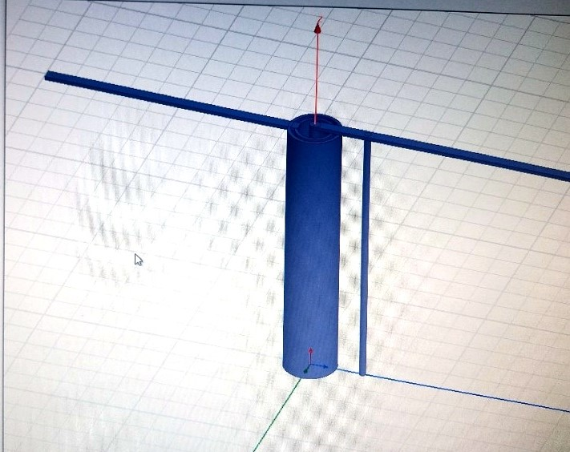
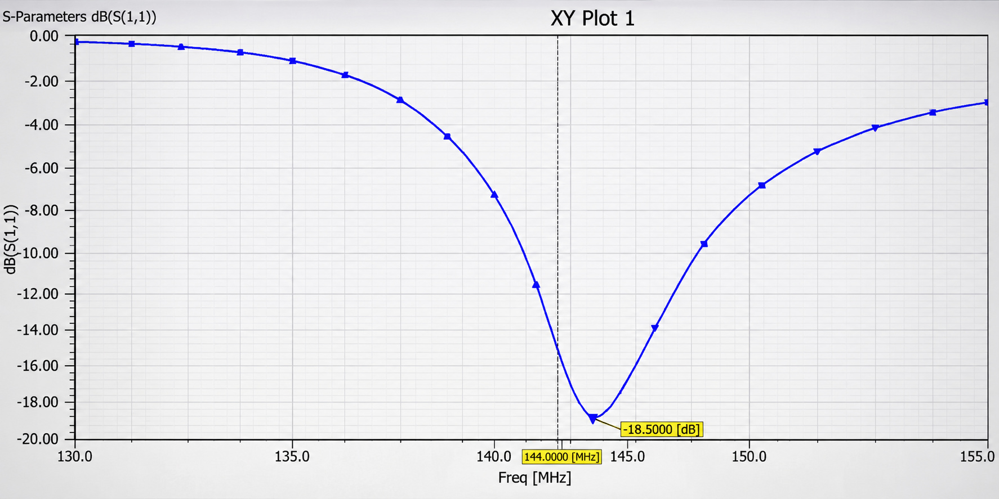
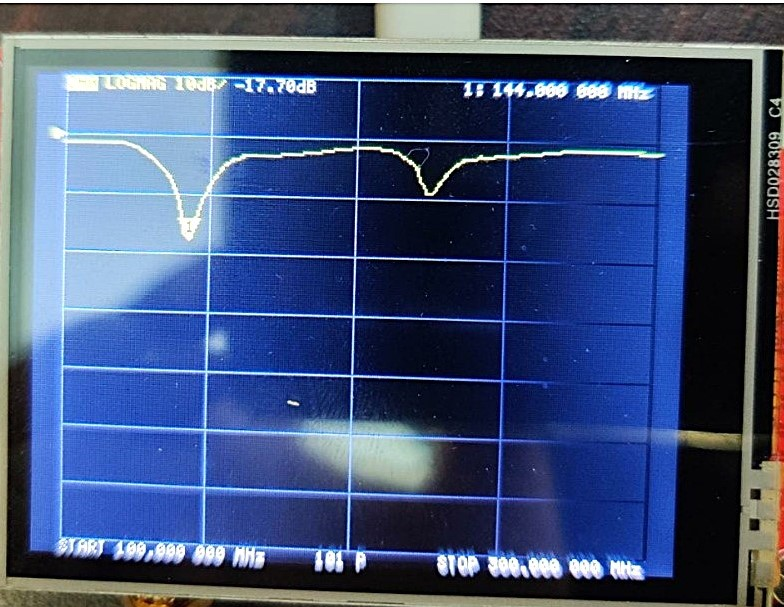

# 144 MHz Dipole Antenna Design, Simulation & Hardware Implementation

## Project Overview

This project focuses on the design, electromagnetic simulation, fabrication, and experimental validation of a dipole antenna operating around **144 MHz**, within the 2-metre amateur radio band.

The antenna was designed and simulated using **Ansys HFSS**, followed by physical fabrication and hardware testing using a Vector Network Analyzer (VNA).

The project demonstrates the complete antenna development process, from electromagnetic modeling to practical hardware implementation and performance evaluation.

## Project Objectives

- Design a dipole antenna for 144 MHz operation.
- Develop a 3D electromagnetic model using Ansys HFSS.
- Analyze antenna impedance matching and return loss.
- Fabricate the antenna according to the designed structure.
- Perform practical measurements using a VNA.
- Evaluate simulated and measured antenna performance.

## Design and Simulation

The antenna geometry was developed and modeled in Ansys HFSS.

The electromagnetic simulation was performed to analyze the antenna's reflection coefficient (S11), resonance behavior, and impedance matching characteristics.

### HFSS Antenna Model

### Simulated S11 Results

**Simulation observations:**

- Target operating frequency: 144 MHz
- Approximate minimum S11: −18.5 dB
- Resonance region: Approximately 144–145 MHz
- Frequency marker: 144 MHz

The simulated response exhibits a pronounced resonance dip near the intended operating frequency, indicating good impedance matching.

At the resonance minimum, approximately 98.6% of the incident power is accepted at the input reference plane, with approximately 1.4% reflected power.

*Note: The accepted-power figure represents power not reflected at the input and does not directly indicate radiation efficiency.*

## Hardware Fabrication

Following the electromagnetic simulation, the antenna was physically fabricated and assembled with a coaxial feeding arrangement.

The fabricated structure was prepared for practical RF characterization.

### Fabricated Antenna

## Hardware Testing and Measurements

The fabricated antenna was experimentally tested using a Vector Network Analyzer (VNA) to evaluate its impedance matching characteristics.

### Measured S11

- Operating frequency marker: 144 MHz
- Measured S11: Approximately −17.70 dB

### Measured VSWR

- Operating frequency marker: 144 MHz
- Displayed VSWR: Approximately 1.18

These measurements indicate promising impedance matching around the intended operating frequency.

**Measurement note:** The displayed S11 and VSWR values should be independently verified at the same frequency and calibration reference plane. An S11 of −17.70 dB corresponds to a VSWR of approximately 1.29, rather than 1.18. This discrepancy should be investigated before reporting the values as a single consistent measurement.

## Simulation vs. Hardware Performance

An important aspect of this project was validating the HFSS antenna design through practical hardware fabrication and experimental testing.

The simulated response exhibits a minimum S11 of approximately −18.5 dB near the 144 MHz operating region, while the hardware measurement indicates an S11 of approximately −17.70 dB at 144 MHz.

The results demonstrate comparable impedance-matching performance between the simulated and fabricated antenna.

Minor differences between simulation and hardware measurements can arise from several practical factors:

- **Fabrication tolerances:** Small variations in antenna dimensions can influence resonance and impedance matching.
- **Material properties:** Actual conductor properties may differ from the material assumptions used in HFSS.
- **Feeding arrangement:** The coaxial cable, connector, and feed-point configuration can affect the input impedance.
- **Simulation conditions:** Idealized simulation conditions may not fully represent the practical environment.
- **Measurement setup:** VNA calibration, cable positioning, and nearby objects can influence measured results.

The comparison demonstrates the importance of practical experimental validation alongside electromagnetic simulation.

For a more rigorous comparison, the simulated and measured S11 values should be extracted at exactly the same frequency and under comparable reference-plane conditions.

## Results Summary

| Parameter | Result |
|---|---:|
| Target operating frequency | 144 MHz |
| Simulated minimum S11 | Approximately −18.5 dB |
| Simulated resonance region | Approximately 144–145 MHz |
| Hardware S11 | Approximately −17.70 dB |
| Hardware VSWR | Approximately 1.18 (displayed) |
| Testing equipment | VNA |

## Tools and Technologies

- **Ansys HFSS** – 3D electromagnetic modeling and simulation
- **Vector Network Analyzer (VNA)** – RF hardware testing
- Antenna Design and RF Engineering
- Electromagnetic Analysis
- Hardware Fabrication and Experimental Validation

## Conclusion

This project demonstrates the complete development of a 144 MHz dipole antenna, encompassing electromagnetic design, HFSS simulation, physical fabrication, and experimental RF characterization.

The HFSS simulation achieved a minimum S11 of approximately −18.5 dB near the intended operating frequency. Hardware testing further demonstrated promising impedance matching, with a measured S11 of approximately −17.70 dB at 144 MHz.

The close agreement between these results provides encouraging evidence of the practical feasibility of the antenna design.

The project highlights the application of electromagnetic simulation and experimental measurement in RF antenna engineering.

## Future Improvements

- Further optimize antenna dimensions to centre resonance precisely at 144 MHz.
- Obtain calibrated simulated and measured S11 sweeps for direct comparison.
- Verify VSWR consistency with measured S11.
- Evaluate radiation patterns and antenna gain.
- Investigate radiation efficiency.
- Explore feeding arrangements and impedance-matching optimization.

---

**Project Domain:** RF Engineering | Antenna Design | Electromagnetic Simulation | Hardware Implementation

**Software:** Ansys HFSS

**Testing Equipment:** Vector Network Analyzer (VNA)

**Author:** Engr. Amna Zaheer
